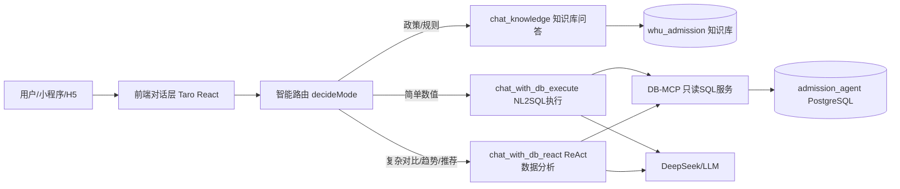
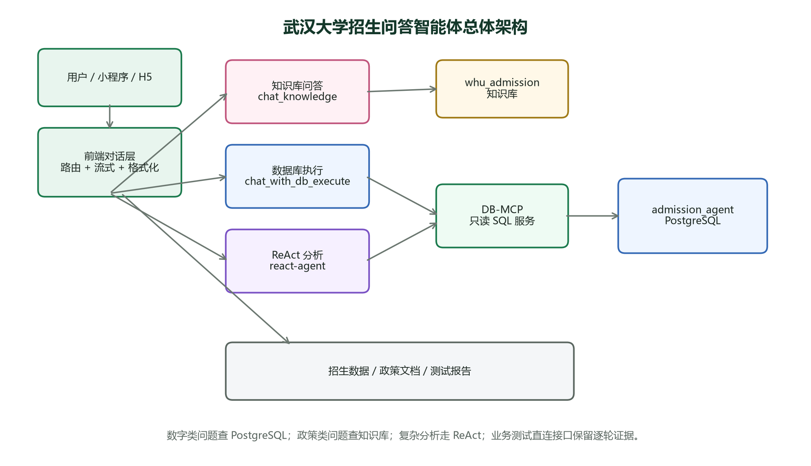

# 武汉大学招生问答智能体总体设计与详细设计

## 1. 文档目的

本文档说明武汉大学招生问答智能体的系统总体设计、模块划分、核心功能点、关键实现、单元测试和业务测试方案。系统面向湖北考生、家长和招生咨询场景，提供招生政策问答、分数/位次查询、招生计划查询、录取趋势对比、冲稳保分析和招生快报等服务。

系统遵循以下设计原则：

1. **数字类问题必须查库**：分数线、位次、计划数、人数、占比等必须由 PostgreSQL 执行 SQL 得出，不允许 RAG 语义召回编造数值。
2. **政策类问题优先知识库**：报考条件、转专业、宿舍、奖助学金、培养政策等非结构化规则由知识库问答处理。
3. **用户侧单入口**：前端不再暴露“知识库/数据库”模式选择，由智能路由根据问题意图选择后端引擎。
4. **可审计、可回归**：所有核心模块均有单元测试；业务场景通过独立业务测试脚本直接调用服务接口，保留逐轮响应、SQL、数据断言和汇总报告。
5. **最小侵入生产链路**：测试发现真实缺陷时做最小修复并回归，不为测试重构生产架构。

## 2. 系统总体架构

### 2.1 架构总览

招生问答智能体采用“前端单入口 + 后端双问答引擎 + 结构化数据库 + 知识库 + MCP 只读执行层”的架构。





### 2.2 顶层模块

| 模块 | 主要职责 | 关键实现 |
|---|---|---|
| 前端对话层 | 对话 UI、流式渲染、模式提示、历史会话 | `whu-admission-miniapp/src` |
| 智能路由 | 判断政策、简单数值、复杂数据、追问继承 | `src/utils/routeMode.ts` |
| 答案格式化 | 清理思考/SQL/异常栈、`<chart-view>` 转表格或图表 | `src/utils/answerFormat.ts` |
| 流式服务客户端 | 调用 DB-GPT SSE，处理增量/非增量/ReAct 帧 | `src/services/dbgpt.ts` |
| 会话状态 | 管理消息、引擎切换、跨引擎会话复用 | `src/store/chatStore.ts` |
| 知识库问答 | 政策、规则、校园话题检索增强问答 | DB-GPT `chat_knowledge` |
| 数据库问答 | NL2SQL、执行 SQL、返回结构化结果和图表 | DB-GPT `chat_with_db_execute` |
| ReAct 数据分析 | 复杂列举、趋势、对比、冲稳保、快报 | DB-GPT `/api/v1/chat/react-agent` |
| fastpath 快速通道 | 一分一段无歧义问题跳过 LLM 直接查库 | `auto_execute/fastpath.py` |
| SQL 安全与归一化 | 强制 SQL、修正跨年/科类/聚合口径 | `auto_execute/chat.py` |
| 输出解析 | chart-view、空结果兜底、错误转可操作提示 | `auto_execute/out_parser.py` |
| MCP 数据服务 | 暴露只读 `list_tables`、`describe_table`、`run_sql` | `db-mcp/db_mcp_server.py` |
| 招生数据库 | 结构化录取、计划、一分一段数据 | PostgreSQL `admission_agent` |
| 单元测试 | Python + Vitest，覆盖后端、MCP、前端路由/格式化/流式/会话 | `DB-GPT/.../tests/admission`、`db-mcp`、`src/**/__tests__` |
| 业务测试 | 24 个招生场景、三引擎、Oracle SQL、报告与断点续跑 | `business_tests/` |

## 3. 功能模块设计

### 3.1 前端对话与路由模块

#### 3.1.1 功能点

- 提供统一对话入口，用户直接输入招生问题。
- 根据问题意图自动选择知识库、数据库执行或 ReAct 分析。
- 对无法判断意图的追问继承上一轮引擎，保证上下文连续。
- 支持流式回答、停止回答、空回答兜底、历史会话管理。

#### 3.1.2 路由规则

`decideMode(text, lastMode)` 的核心策略：

1. 命中政策/规则/校园话题意图 → `chat_knowledge`。
2. 命中简单数值意图（分数、位次、计划数、单年事实）→ `chat_with_db_execute`。
3. 命中复杂数据意图（列举、趋势、对比、跨年、冲稳保、快报）→ `chat_with_db_react`。
4. 均不命中（如“那 2023 年呢”）→ 继承 `lastMode`。

关键文件：[routeMode.ts](file:///e:/postgres%20agent/whu-admission-miniapp/src/utils/routeMode.ts)。

### 3.2 答案格式化与展示模块

#### 3.2.1 功能点

- 剥离模型思考、SQL、异常栈、表名等技术细节。
- 将 `<chart-view>` 中的结构化数据转换为 Markdown 表格、单值粗体或图表代码块。
- 对单行单列结果显示大字数值；多行结果显示表格。
- 图表使用前端 Canvas 自绘柱状图、折线图、饼图，不引入第三方图表库。

关键文件：[answerFormat.ts](file:///e:/postgres%20agent/whu-admission-miniapp/src/utils/answerFormat.ts)、`MiniChart` 组件。

### 3.3 流式服务客户端模块

#### 3.3.1 功能点

- 支持知识库增量 SSE、execute 非增量快照 SSE、ReAct 事件流。
- 对 `[DONE]`、ReAct `done`、静默超时统一幂等收尾。
- 网络错误转换为友好提示，避免暴露底层异常。

#### 3.3.2 关键修复

正常结束帧会先设置 `finished`，旧收尾逻辑因 `finished` 直接返回，可能不触发 `onDone`，导致页面一直显示“回答中”。已改为由 `doneFired/cancelled` 保证幂等，且 `[DONE]` 和 ReAct `done` 都会触发 `onDone`。

关键文件：[dbgpt.ts](file:///e:/postgres%20agent/whu-admission-miniapp/src/services/dbgpt.ts)。

### 3.4 知识库问答模块

#### 3.4.1 功能点

- 基于 `whu_admission` 知识空间回答政策规则类问题。
- 文档切片策略为 `CHUNK_BY_MARKDOWN_HEADER`，优先保留表格与问答结构。
- 已覆盖国家专项、转专业、宿舍、奖助学金、强基、中外合作、就业等主题。

#### 3.4.2 约束

- 知识库不用于分数线、位次、计划数等精确数值。
- 长回答中出现部分内容不足时，不触发无谓跨引擎重试；只有短回答且命中“内容不足”模式才兜底。

### 3.5 数据库问答执行模块

#### 3.5.1 功能点

- 将自然语言转换为 SQL，并通过 MCP 实际执行。
- 对一分一段简单问题使用 fastpath，跳过 LLM。
- 强制数据意图必须输出 SQL，避免模型直接编造结论。
- 返回 SQL、数据行和 `<chart-view>`，前端格式化展示。

#### 3.5.2 fastpath

`match_fast_sql()` 处理年份、科类、分数/位次四类无歧义查询：

- 分数转位次。
- 位次转分数。
- 某分数以上人数/百分比。
- 明确单年单科类一分一段事实。

跨年、多年份、趋势、对比、复杂筛选一律回落 LLM。

关键文件：[fastpath.py](file:///e:/postgres%20agent/DB-GPT/packages/dbgpt-app/src/dbgpt_app/scene/chat_db/auto_execute/fastpath.py)。

#### 3.5.3 SQL 防护与归一化

`_needs_sql()` 识别数据意图并追加 SQL 强制提示；`_normalize_admission_sql()` 修正常见口径错误：

- “去年”按当前题库语境归一回完整年份。
- 跨年查询使用归一化科类列 `category_norm`。
- 专业组分数与位次必须来自同一行，禁止 `MIN(min_score)` 与 `MIN(min_rank)` 跨行拼接。
- 禁止用专业名列做院校名过滤。

关键文件：[chat.py](file:///e:/postgres%20agent/DB-GPT/packages/dbgpt-app/src/dbgpt_app/scene/chat_db/auto_execute/chat.py)。

### 3.6 ReAct 数据分析模块

#### 3.6.1 功能点

- 处理列举全部专业组、多年趋势、类别对比、冲稳保、快报等复杂问题。
- 可以调用数据库工具和知识库工具，最终以 Markdown 输出。
- 纯问答场景禁止写文件、禁止调用代码解释器生成 HTML；只有用户明确要求报告/网页时才允许 `html_interpreter`。

#### 3.6.2 接口契约

业务测试调用 `/api/v1/chat/react-agent`，`chat_mode` 仍映射为 `chat_with_db_execute`，通过 `ext_info` 传递：

```json
{
  "database_name": "admission_agent",
  "knowledge_space": "whu_admission"
}
```

关键文件：[agentic_data_api.py](file:///e:/postgres%20agent/DB-GPT/packages/dbgpt-app/src/dbgpt_app/openapi/api_v1/agentic_data_api.py)。

### 3.7 输出解析模块

#### 3.7.1 功能点

- 解析模型 JSON、SQL、`direct_response`。
- 提取 `<chart-view>` 中的 SQL 与数据。
- 空结果时追加可操作说明：该年份或类别暂无数据，建议换年份或去掉筛选。
- 模型既无 SQL 又无 direct_response 时返回可操作提示，不把 traceback 暴露给用户。

关键文件：[out_parser.py](file:///e:/postgres%20agent/DB-GPT/packages/dbgpt-app/src/dbgpt_app/scene/chat_db/auto_execute/out_parser.py)。

### 3.8 MCP 只读数据服务模块

#### 3.8.1 功能点

- 以 SSE 协议暴露数据库能力。
- 提供 `list_tables`、`describe_table`、`run_sql`。
- 只允许只读查询，拒绝 INSERT/UPDATE/DELETE/DROP/ALTER 等写操作。
- 正确序列化 Decimal、日期等数据库类型。

关键文件：[db_mcp_server.py](file:///e:/postgres%20agent/db-mcp/db_mcp_server.py)。

## 4. 数据库设计

数据库为 PostgreSQL `admission_agent`，当前核心表如下：

| 表名 | 用途 | 覆盖范围 |
|---|---|---|
| `hubei_score_ranks` | 湖北一分一段表 | 2018-2025 |
| `hubei_major_admissions` | 分专业招生计划 | 2021-2025 |
| `whu_group_admissions` | 专业组投档线与位次 | 2022-2026 |
| `whu_major_records` | 分专业录取明细 | 2019-2025 |
| `whu_school_summary` | 院校分类汇总 | 2019-2026 |
| `whu_data_coverage` | 年度覆盖说明 | 数据覆盖查询 |

关键口径：

1. `hubei_score_ranks.cumulative_count` 为官方累计位次。
2. 专业组分数与位次在 `whu_group_admissions` 中天然同行，查询时不得重新聚合拼接。
3. 跨年科类统一使用 `category_norm`（物理/历史/不分文理），单年可使用 `subject_type`。
4. `whu_data_coverage` 用于回答“有没有某年份/某类数据”。

## 5. 单元测试设计

### 5.1 Python 单元测试

| 测试文件 | 覆盖内容 |
|---|---|
| `DB-GPT/.../tests/admission/test_fastpath.py` | 分数转位次、位次转分数、同义表达、跨年回落、趋势回落 |
| `DB-GPT/.../tests/admission/test_admission_sql_guards.py` | 数据意图强制 SQL、去年归一化、科类保护、聚合防跨行 |
| `DB-GPT/.../tests/admission/test_out_parser.py` | 模型 JSON、纯 SQL、direct_response、空结果、异常兜底 |
| `db-mcp/test_db_mcp_server.py` | 只读 SQL 校验、表结构、Decimal/日期序列化、异常 JSON |

### 5.2 前端 Vitest

| 测试文件 | 覆盖内容 |
|---|---|
| `src/utils/__tests__/routeMode.test.ts` | 政策、简单数据、复杂数据、追问继承、空输入 |
| `src/utils/__tests__/answerFormat.test.ts` | 思考/SQL 清理、表名业务化、单值、表格、图表、空数据 |
| `src/store/__tests__/chatStore.test.ts` | 跨引擎会话复用、知识不足单向兜底、数据库不反向重试 |
| `src/services/__tests__/dbgpt.test.ts` | 增量帧、非增量快照、`[DONE]`、ReAct final/done、网络错误 |

## 6. 业务测试设计

### 6.1 测试目标

业务测试模拟招生问答真实需求，直接调用服务接口，验证：

1. 政策问答能返回知识库内容。
2. 分数/位次/计划数等数据题必须查 SQL，且数值与 Oracle SQL 一致。
3. 专业组“分数-位次”必须来自同一记录，禁止跨行拼接。
4. ReAct 能处理复杂数据问题，且不把中间 Thought 作为最终答案。
5. 多轮追问能复用同引擎会话。
6. 跨引擎追问能分别维护各引擎会话。
7. 异常输入、空结果、服务错误有可处理输出。

### 6.2 场景组织

当前共 24 个场景、29 轮，其中 8 个 smoke 场景。能力覆盖：

- `policy`：招生政策问答。
- `data_query`：招生智能问数。
- `analysis`：趋势、对比、冲稳保。
- `report`：招生快报。
- `multi_turn`：同引擎与跨引擎多轮。
- `robustness`：异常与健壮性。

关键文件：[scenarios.json](file:///e:/postgres%20agent/business_tests/scenarios.json)、[run_business_tests.py](file:///e:/postgres%20agent/business_tests/run_business_tests.py)。

### 6.3 断言能力

业务测试支持以下断言：

| 断言 | 说明 |
|---|---|
| `contains_all` | 文本必须包含全部关键词 |
| `contains_any` | 文本至少包含一个关键词 |
| `forbidden` | 禁止出现指定词 |
| `sql_required` | 数据题必须返回 SQL |
| `min_rows` | 数据行数不少于阈值 |
| `row_count` | 数据行数精确匹配 |
| `expected_values` | 期望值必须出现在文本或数据中 |
| `paired_values` | 多值必须来自同一数据行或同一文本行，防止跨行拼接 |
| `clarify_slots` | 缺关键信息时必须追问 |
| `oracle_sql` | 用只读基准 SQL 校验真实答案数值 |
| `max_elapsed` | 单轮耗时上限 |

### 6.4 运行与输出

```bash
python business_tests/run_business_tests.py --suite smoke --base-url http://127.0.0.1:5670
python business_tests/run_business_tests.py --suite full --base-url http://127.0.0.1:5670
```

输出目录：`business_tests/results/<run_id>/`

包含：

- `records.jsonl`：逐轮问题、模式、原始响应、最终文本、SQL、数据、断言、Oracle 结果、耗时。
- `summary.json`：整体通过/失败/错误统计。
- `report.md`：Markdown 报告。

## 7. 测试与构建结果

### 7.1 单元测试结果

| 测试范围 | 命令 | 结果 |
|---|---|---|
| DB-GPT 招生模块 | `pytest -q DB-GPT/packages/dbgpt-app/src/dbgpt_app/tests/admission` | 41 项通过 |
| MCP 只读服务 | `$env:PYTHONPATH="e:\postgres agent\db-mcp"; pytest -q db-mcp/test_db_mcp_server.py` | 10 项通过 |
| 前端 Vitest | `npm run test:run` | 4 个文件、28 项通过 |
| 业务框架离线单测 | `pytest -q business_tests/test_run_business_tests.py` | 23 项通过 |
| 业务场景静态校验 | `python business_tests/run_business_tests.py --validate-only` | 24 个场景、29 轮通过 |

前端 TypeScript 检查中仅剩 `node_modules` 内的既有类型噪音；`src` 目录错误已清零。

前端测试中额外覆盖了离线演示降级：后端不可达时由 `src/services/demo.ts` 逐字输出内置样例并在末尾标注"离线演示数据"，非网络类错误仍正常上报、不被演示逻辑掩盖。

### 7.2 业务测试实测结果

执行命令：

```bash
python business_tests/run_business_tests.py --suite full --timeout 120 --base-url http://127.0.0.1:5670
```

执行时间：2026-11-07 10:15:37 — 10:19:14，结果目录 `business_tests/results/20261107_101537_04c95cd4`。

| 指标 | 结果 |
|---|---|
| 选中场景 | 24 |
| 完成场景 | 24 |
| 通过场景 | 24 |
| 失败 / 错误场景 | 0 / 0 |
| 交互轮次 | 29 |
| 失败 / 错误轮次 | 0 / 0 |

各能力域耗时：

| 能力域 | 场景数 | 平均耗时（秒） |
|---|---|---|
| 政策问答 policy | 5 | 6.92 |
| 智能问数 data_query | 7 | 3.73 |
| 分析推断 analysis | 3 | 10.62 |
| 招生快报 report | 2 | 30.84 |
| 多轮问答 multi_turn | 3 | 12.35 |
| 异常健壮性 robustness | 4 | 6.37 |
| 全部场景 | 24 | 9.03 |

整体耗时分布：P50 5.04 秒，P90 18.61 秒，最长 51.10 秒（2024 招生快报，ReAct 多步查库并组织长文），最短 2.75 秒。

代表性验证结论：

1. 政策问答：国家专项报考、转专业、宿舍条件、奖助学金、专项与普通类差异均返回知识库内容。
2. 智能问数：2024 物理 647/3218、649/2879、653/2315 三组分数位次全部同行命中；2024/2025 计划 1698/1704；2023–2025 物理普通类最低分 644/641/634。
3. 分析推断：物理+化学 2024 计划 1139、记录 41 条、最低 627、最高 677；计算机类计划变化经 ReAct 分析通过。
4. 招生快报：2024 快报与 2025 普通类录取快报均生成标题含“快报”的结构化结果。
5. 多轮：execute 追问、知识库追问、跨知识库/execute/ReAct 四轮均正确复用各自 `conv_uid`。
6. 健壮性：信息不足时主动澄清，2026 分专业缺口如实说明，同分规则解释正确，不作出录取保证。

### 7.3 构建验证

| 构建目标 | 命令 | 结果 |
|---|---|---|
| 微信小程序 | `npm run build:weapp` | 成功 |
| H5 | `$env:TARO_OUTPUT_DIR="dist-h5"; npm run build:h5` | 成功 |

### 7.4 架构图


## 8. 已知限制与后续优化

1. 上游 LLM 偶发超时会导致单轮失败，业务测试已加墙钟硬超时（默认 90 秒，可按场景通过 `--timeout` 调整）并记录错误，不再挂死。
2. execute 链路部分回答的最终引导语较短，核心结论依赖 `<chart-view>` 数据；前端格式化已负责渲染。
3. 知识库仍可能存在政策文档缺口，遇到缺口时模型会如实说明，需补充官方文档。
4. 2026 年当前无分专业数据和一分一段表，专业组分数线和位次以 `whu_group_admissions` 为准。

## 9. 交付清单

| 类型 | 路径 |
|---|---|
| 设计文档 Markdown | `docs/whu_admission_system_design.md` |
| 设计文档 Word | `docs/whu_admission_system_design.docx` |
| 业务测试执行器 | `business_tests/run_business_tests.py` |
| 业务测试场景 | `business_tests/scenarios.json` |
| 业务测试离线单测 | `business_tests/test_run_business_tests.py` |
| Python 单元测试 | `DB-GPT/.../tests/admission/`、`db-mcp/test_db_mcp_server.py` |
| 前端单元测试 | `whu-admission-miniapp/src/**/__tests__/` |
